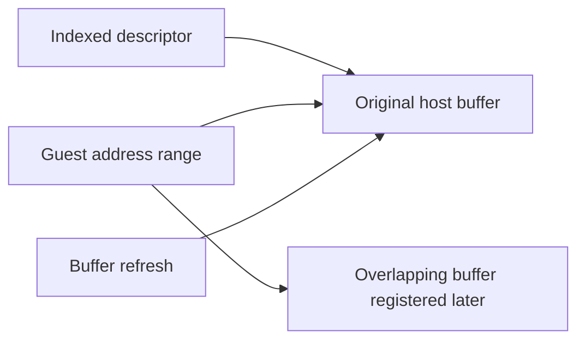

# VIctory Buffer Sync

An experimental [VIctory](https://github.com/Marvisak/VIctory) fork with a
Direct3D 12 fix for buffers accessed through indexed descriptors. Based on
the public [LooperSalty/victory branch](https://github.com/LooperSalty/victory/tree/anyxboxx/fork-7b0-lot5)
at `fd021bf`.

## Verification

| Check | Result |
| --- | --- |
| Windows build | Diagnostic build passed with Rust 1.100.0 and MSVC. |
| Indexed buffer selection | Synthetic regression passed on the Direct3D 12 software adapter (WARP). It verifies that an overlapping registration leaves the descriptor's refresh target pointing at the original host buffer. |
| Gameplay | Rendering quality, frame rate, stability, and VRAM use remain unverified on this revision. |

## What changed

The refresh path uses the host buffer retained by the indexed descriptor
slot. When a new buffer is registered at an overlapping guest address, the
existing descriptor still reads its original host buffer.



Run the checks from a Windows x64 Developer PowerShell with stable Rust
installed.

```powershell
cargo +stable build --profile diag --locked -p victory --features diagnostics
$env:VICTORY_D3D12_WARP = '1'
cargo +stable test --profile diag --locked -p victory-gpu --features diagnostics --lib indexed_view_refreshes_the_buffer_it_was_bound_to
```

## Scope and credits

VIctory is an independent Windows compatibility layer. See the
[project architecture](docs/architecture.md) and [asset policy](docs/asset-policy.md).
Keep game files and derived data outside the repository.

The compatibility layer comes from [Marvisak and the VIctory contributors](https://github.com/Marvisak/VIctory).
The public base revision records the [base fork's credits and notes](https://github.com/LooperSalty/victory/blob/fd021bf26a7003749d668e5d9bf6b234bfab2e47/README.md).

## Getting started

Requirements: Windows 10/11 x64, a CPU with AVX2, a Direct3D 12 GPU with
shader model 6.6 (and mesh shaders for the world), Rust (pinned in
`rust-toolchain.toml`).

The title also needs several GiB of available Windows commit at startup.
Check **Committed** under **Task Manager → Performance → Memory**. If
`crashes.log` reports Windows error 1455, close other applications or increase
the Windows paging file size, then retry.

```powershell
cargo xtask install-hooks                # asset-policy check on every commit
copy victory.example.toml victory.toml   # then set your paths (outside the repo)
cargo test --workspace                   # needs no game data
cargo run -p victory -- config           # check your paths
```

Run the title:

```powershell
cargo build --release -p victory
target\release\victory.exe run <game dir>\<the title's exe> --execute
```

The window caption shows the framerate. Saves, settings and `crashes.log`
are kept under the data folder (default `%LOCALAPPDATA%\victory\data`), derived
data under the cache folder.

Input: XInput pads. With none connected the keyboard is a pad while the
title's window has focus:

| Keys | Pad |
|------|-----|
| W A S D / I J K L | left / right stick |
| arrows | D-pad |
| Enter, Backspace, X, Y | A, B, X, Y |
| Q / E, Z / C | shoulders, triggers |
| F / H | stick clicks |
| Esc, Tab | Menu, View |

## Commands

```
victory inspect <exe|dll> [--imports] [--exports]
victory census [paths...] [--missing] [--strict]
victory lib-exports <import.lib> [--list]
victory shader-info [paths...] [--verbose] [--disasm]
victory translate [paths...] [--validate] [--pipelines] [--list] [--jobs N]
victory run <exe> [--execute] [--unimplemented trap|zero] [--strict]
            [--console series-x|series-s] [-- <title arguments>]
victory config
```

Logging: `VICTORY_LOG=victory_loader=trace,info` (a release build logs
info and above).

## Debugging

A release build has no debugging aids. Build them in with

```powershell
cargo build --profile diag -p victory --features diagnostics   # target\diag\victory.exe
```

| Variable | Effect |
|----------|--------|
| `VICTORY_LOG=<target>=debug,...` | debug and trace output |
| `VICTORY_STACKS=20,60` | every thread's stack at those seconds |
| `VICTORY_WATCH=<rva>,...` | logs a title u32 when it changes |
| `VICTORY_KEYS=30:Enter,35:X` | presses keys at those seconds, focus or not |
| `VICTORY_CRASH_SAVE=<rva>:<len>,...` | saves title memory to the cache folder on a crash |
| `VICTORY_CAPTURE=<dir>` | saves presented frames (powers of two, or `VICTORY_CAPTURE_FRAMES=<list>`) |
| `VICTORY_DUMP_TARGETS=1` | with the two above, saves every render target of those frames |
| `VICTORY_D3D12_DEBUG=1` | host debug layer |
| `VICTORY_D3D12_GBV=1` | with the above, GPU-based validation (bad descriptor use reported, not faulted; slow) |
| `VICTORY_D3D12_DRED=1` | on a GPU failure, the allocation hit and the commands in flight |
| `VICTORY_PIPELINE_WAIT_MS=24` | reduce the per-frame wait for background pipeline creation from the default of 500 ms. A draw can be omitted until its pipeline is ready |
| `VICTORY_SKIP_PIPELINES=<hash>,...` | omit draws and dispatches, including indirect ones, whose pipeline contains a listed 16-digit shader hash |
| `VICTORY_GPU_TIMING=1` | with the above, each list of a submission run and timed on its own; slow lists logged with their slowest commands |
| `VICTORY_D3D12_WARP=1` | host device on the software adapter (slow; cannot reset the driver) |
| `VICTORY_SHADER_LOOP_LIMIT=<n>` | translated shader loops stop after `n` iterations per lane instead of 2^20 (own shader cache entries); if a lower `n` makes world frames much faster, loops hitting the limit are what makes them slow |
| `VICTORY_AUDIO_CAPTURE=<file.wav>` | records what the title plays (our process only) |
| `VICTORY_XMA_DUMP=<dir>` | saves the first 32 XMA voices' context and input |

Every build appends crashes and host GPU failures to `crashes.log` in the
title's data folder.

## License

GPL-3.0-or-later. See [LICENSE](LICENSE).
